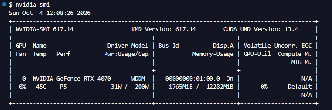
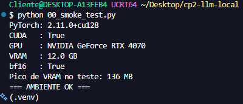
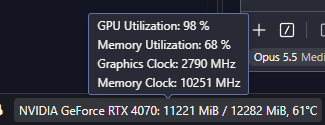
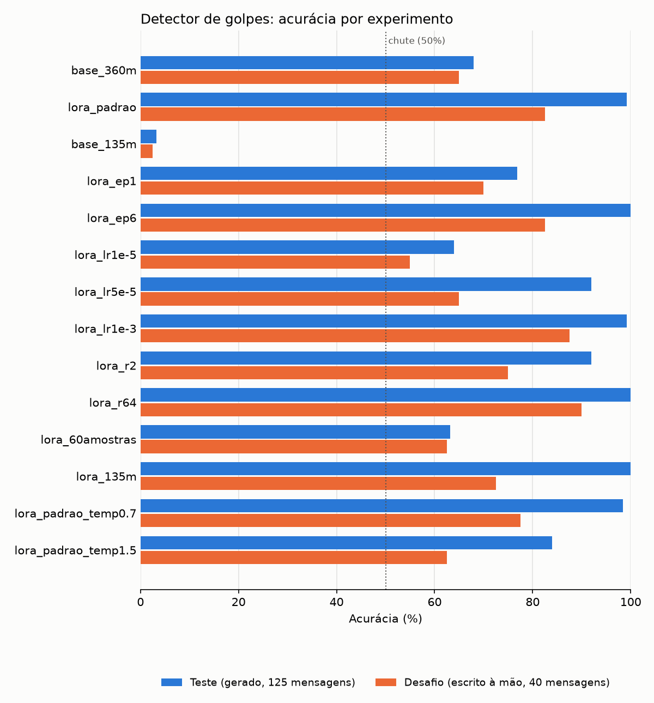
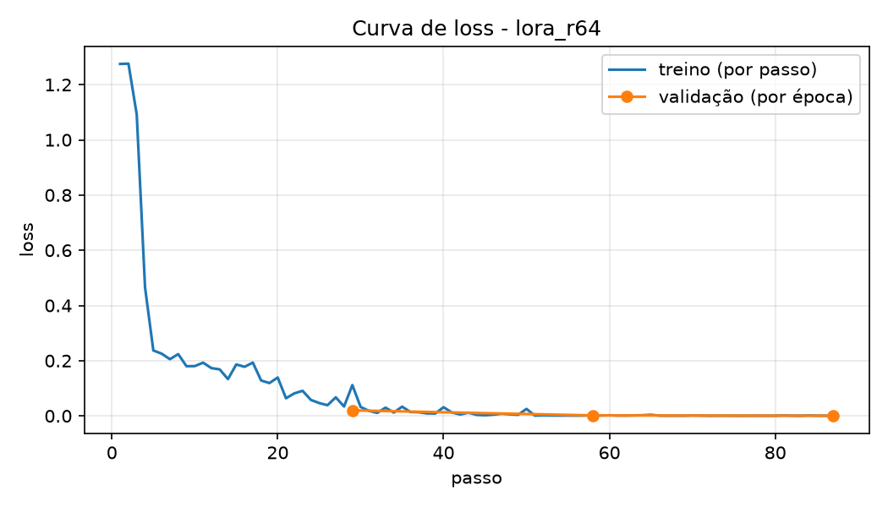
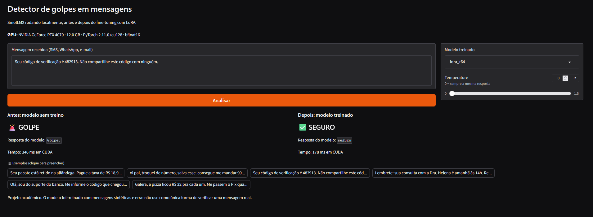

# Detector de golpes em mensagens com SmolLM2

**CP2/CP3 · Generative AI for Engineering · FIAP 4ESPV · Prof. Dr. Francisco Elânio**

Treinamos uma LLM pequena, rodando localmente em GPU, para ler uma mensagem (SMS, WhatsApp ou e-mail) e responder **`golpe`** ou **`seguro`**. O modelo base, o SmolLM2-360M-Instruct, acerta 68% das mensagens sem treino. Depois de um fine-tuning com LoRA de 20 segundos numa RTX 4070, o melhor modelo chega a **100% no teste** e **90% num conjunto de mensagens escritas à mão** que não seguem os modelos do treino.

## Integrantes

| Nome | RM |
|---|---|
| Gabriel Diegues Figueiredo Rocha | RM550788 |
| Henrique Pontes Oliveira | RM98036 |
| Pedro Henrique Palladino | RM551180 |
| Raí Gumieri dos Santos | RM98287 |

## Onde está cada item do enunciado

| # | Item pedido | Onde está |
|---|---|---|
| 1 | Selecionar a LLM | [Modelo escolhido](#1-modelo-escolhido) |
| 2 | Problema específico | [O problema](#2-o-problema) e [Dataset](#4-dataset) |
| 3 | Testar diferentes parâmetros | [Experimentos](#7-experimentos-item-3), 14 configurações |
| 4 | Avaliar o modelo (respostas) | [Como avaliamos](#6-como-avaliamos), `02_avaliar.py` |
| 5 | Todos os testes em GPU | Todo resultado em `resultados/*.json` registra GPU, dtype e pico de VRAM |
| 6 | Frontend para prompts e respostas | [Frontend](#9-frontend-item-6), `06_app.py` |
| 7 | Print da GPU funcionando no VSCode | [Ambiente e GPU](#3-ambiente-e-gpu-itens-5-e-7) |
| 8 | Documentação e código no GitHub | Este repositório |

## 1. Modelo escolhido

**[SmolLM2-360M-Instruct](https://huggingface.co/HuggingFaceTB/SmolLM2-360M-Instruct)** (Hugging Face, 362 milhões de parâmetros), a mesma família usada nas aulas.

- **Cabe com folga na GPU.** O treino usou no máximo 7,7 GB dos 12 GB da RTX 4070.
- **É a versão Instruct**, que já entende o formato de conversa (sistema, usuário, assistente) e responde de forma curta.
- **Comparamos com o SmolLM2-135M-Instruct** para medir o efeito do tamanho do modelo. O 1.7B não entrou nos testes porque o 360M já resolve bem a tarefa.

## 2. O problema

Golpes por mensagem (falso banco, taxa de entrega, "troquei de número", vaga falsa, pedido de código) são comuns no Brasil. A tarefa do modelo é classificar uma mensagem em **uma palavra**:

```
Sistema : Você é um detector de golpes em mensagens. Leia a mensagem e responda
          com apenas uma palavra: golpe ou seguro.
Usuário : Mensagem: Seu pacote está retido. Pague a taxa de R$ 12,90 em http://... para liberar.
Modelo  : golpe
```

A resposta curta permite corrigir automaticamente cada resposta, como o pass@1 da aula 7.

## 3. Ambiente e GPU (itens 5 e 7)

| Componente | Versão |
|---|---|
| GPU | NVIDIA GeForce RTX 4070, 12 GB |
| Driver | 617.14 (suporta CUDA até 13.4) |
| PyTorch | 2.11.0+cu128 |
| Precisão | bfloat16 (suportado pela placa) |
| Sistema | Windows, VSCode, Python em ambiente virtual (`.venv`) |

Não foi preciso instalar o CUDA Toolkit separado: o pacote do PyTorch `cu128` já traz o runtime CUDA, compatível com o driver da placa.

**VSCode durante o treino, com a extensão de monitoramento da GPU:**


**Driver reconhecendo a placa (`nvidia-smi`):**



**Teste de ambiente (`00_smoke_test.py`) no terminal do VSCode, com uma multiplicação de matrizes real na GPU:**



**Extensão de monitoramento da GPU com a placa em uso (98% de utilização):**



## 4. Dataset

Mensagens geradas por código (`01_dados.py`), na mesma lógica da aula 7: cada **família** é um tipo de mensagem, e modelos de frase combinados com listas de valores geram as variações. Empresas, links, telefones e chaves Pix são **fictícios**.

| Rótulo | Famílias no treino |
|---|---|
| `golpe` (8) | falso banco, taxa de entrega, prêmio falso, falso parente pedindo Pix, vaga falsa, pedido de código, dívida falsa, investimento milagroso |
| `seguro` (9) | código de verificação legítimo, entrega, lembrete de consulta, conversa pessoal, Pix entre conhecidos, aviso de banco legítimo, promoção, trabalho/escola, conta de serviço |

Várias mensagens seguras citam banco, Pix, valores e códigos **de propósito**, para o modelo não aprender o atalho "falou de banco, é golpe".

| Arquivo | Mensagens | Uso |
|---|---|---|
| `dados/treino.jsonl` | 510 (240 golpe, 270 seguro) | Treino. 10% dele é separado como validação. |
| `dados/teste.jsonl` | 125 | **Nunca entra no treino.** 85 "variações" (família conhecida, combinação nova) e 40 "inéditas" (4 famílias que não existem no treino: multa de trânsito falsa, recadastramento falso, aviso de condomínio, reserva confirmada). |
| `dados/desafio.jsonl` | 40 (20 golpe, 20 seguro) | Mensagens **escritas à mão** (`01b_desafio.py`), sem usar nenhum modelo de frase do gerador: gírias, abreviações, golpes sem link e mensagens seguras com "cara de golpe". |

O script confere que nenhuma mensagem do teste aparece no treino.

## 5. Como treinamos

`03_treinar.py`, com o laço da aula: **forward → loss → backward → step**.

- **LoRA** nas camadas de atenção e MLP (`q, k, v, o, gate, up, down`). No `lora_padrao` (rank 16) são 8,7 milhões de parâmetros treináveis, 2,34% do total.
- **A loss só cobra a resposta.** Os tokens do sistema e da mensagem recebem rótulo `-100` e são ignorados, como na aula 7 ("enunciado ignorado, código cobrado").
- **Pesos em float32 com cálculo em bfloat16** (autocast): as atualizações pequenas do LoRA não se perdem por falta de precisão, e a conta continua rápida na GPU.
- **Otimizador AdamW**, warmup de 5% e decaimento linear do learning rate, seed fixa (42).
- **Configuração de referência (`lora_padrao`):** 3 épocas, learning rate 2e-4, rank 16, alpha 32, lote 16, 87 passos.

## 6. Como avaliamos

`02_avaliar.py` aplica a **mesma prova** a qualquer modelo (antes ou depois do treino), com temperature 0 (resposta determinística):

- **Acurácia**: no teste inteiro, separada em variação e inéditas, e no desafio.
- **Precisão e recall da classe golpe.** O recall importa mais: um golpe classificado como seguro é o erro mais grave.
- **Respostas fora do formato**: quando o modelo não responde nem "golpe" nem "seguro".
- **Resultado por família** e exemplos de erro.

Cada avaliação é salva em `resultados/<nome>.json`, com todas as respostas do modelo e as informações da GPU.

## 7. Experimentos (item 3)

`04_experimentos.py` treina e avalia 14 configurações, mudando **um parâmetro por vez** em relação ao `lora_padrao`. `05_comparar.py` gera a tabela completa ([`resultados/tabela.md`](resultados/tabela.md)) e o gráfico.

| Experimento | O que muda | Teste % | Inéditas % | Desafio % | Recall golpe (desafio) % | Precisão golpe (desafio) % | Treino (s) | VRAM treino (MB) |
|---|---|---|---|---|---|---|---|---|
| base_135m | 135M, sem treino | 3,2 | 2,5 | 2,5 | 5 | 50 | - | - |
| base_360m | 360M, sem treino | 68 | 82,5 | 65 | 85 | 60,7 | - | - |
| **lora_padrao** | referência | 99,2 | 100 | 82,5 | 80 | 84,2 | 18,4 | 7293 |
| lora_ep1 | 1 época | 76,8 | 87,5 | 70 | 55 | 78,6 | 6,4 | 7293 |
| lora_ep6 | 6 épocas | 100 | 100 | 82,5 | 85 | 81 | 40,7 | 7293 |
| lora_lr1e-5 | LR 1e-5 | 64 | 65 | 55 | 20 | 66,7 | 21,4 | 7293 |
| lora_lr5e-5 | LR 5e-5 | 92 | 100 | 65 | 80 | 61,5 | 20,5 | 7293 |
| lora_lr1e-3 | LR 1e-3 | 99,2 | 97,5 | 87,5 | 95 | 82,6 | 19,6 | 7293 |
| lora_r2 | rank 2 | 92 | 97,5 | 75 | 70 | 77,8 | 19 | 7179 |
| **lora_r64** | rank 64 | **100** | **100** | **90** | **95** | **86,4** | 19,6 | 7686 |
| lora_60amostras | 60 exemplos de treino | 63,2 | 77,5 | 62,5 | 85 | 58,6 | 3,1 | 7213 |
| lora_135m | modelo 135M | 100 | 100 | 72,5 | 70 | 73,7 | 16,8 | 4373 |
| lora_padrao_temp0.7 | temperature 0,7 na resposta | 98,4 | 97,5 | 77,5 | 80 | 76,2 | - | - |
| lora_padrao_temp1.5 | temperature 1,5 na resposta | 84 | 85 | 62,5 | 55 | 73,3 | - | - |



### O que cada parâmetro mostrou

- **Épocas.** Uma época é pouco (70% no desafio). De 3 para 6 épocas o treino dobra de tempo e o desafio não melhora (82,5% nos dois).
- **Learning rate.** Com só 87 passos de treino, LR baixo não dá tempo de aprender. Com 1e-5 o modelo ficou **pior que sem treino**: aprendeu o formato da resposta, mas passou a dizer "seguro" para quase tudo (recall de golpe de 20%). Entre os valores testados, 1e-3 foi o melhor.
- **Rank do LoRA.** Mais capacidade no adaptador ajudou (75% → 82,5% → 90% no desafio), com custo pequeno: 400 MB a mais de VRAM e o mesmo tempo.
- **Quantidade de dados.** Com 60 exemplos o modelo não aprende (62,5% no desafio). Nesse experimento, menos dados também significa menos passos de treino (12 em vez de 87), então os dois efeitos aparecem juntos.
- **Tamanho do modelo.** Sem treino, o 135M quase nunca responde no formato pedido: 154 de 165 respostas não continham nem "golpe" nem "seguro". Depois do treino ele vai a 100% no teste, o maior salto da tabela, o que mostra que o fine-tuning ensina primeiro a forma da resposta. No desafio, porém, ele generaliza pior que o 360M (72,5% contra 82,5%).
- **Temperature.** Para classificar, sortear a resposta só atrapalha: o desafio cai de 82,5% (temperature 0) para 62,5% (1,5), com 11 respostas fora do formato.

### Teste x desafio

Os modelos treinados chegam a 99–100% no teste, mas ficam entre 72,5% e 90% no desafio. O teste vem dos mesmos geradores de frases do treino, então mede principalmente se o modelo aprendeu aqueles padrões. O desafio mostra o que acontece com mensagens escritas de outro jeito, e é a medida mais honesta do detector. É a mesma lição da aula 7: longe dos dados, o modelo erra mais.

## 8. Modelo final: `lora_r64`

Escolhemos o `lora_r64` (3 épocas, LR 2e-4, rank 64, alpha 128): 100% no teste, 90% no desafio, recall de golpe de 95% e precisão de 86,4% no desafio.



A loss de validação cai junto com a de treino, sem sinal de overfitting nas 3 épocas.

## 9. Frontend (item 6)

`06_app.py` abre uma página em Gradio (`http://127.0.0.1:7860`). O usuário cola uma mensagem e vê, **lado a lado, a resposta do modelo sem treino e do modelo treinado**, com o tempo de resposta na GPU (cerca de 200 ms). Na própria tela dá para trocar o modelo treinado e a temperature.



No exemplo acima, o modelo sem treino classifica um código de verificação legítimo como golpe; o treinado acerta.

## 10. Como reproduzir

Pré-requisitos: GPU NVIDIA, Python 3.10 ou mais novo.

```bash
# 1. Ambiente
python -m venv .venv
.venv\Scripts\activate                 # Windows (cmd/PowerShell)
# source .venv/Scripts/activate        # Git Bash

# 2. PyTorch com CUDA (escolha o índice compatível com o seu driver em pytorch.org)
pip install torch --index-url https://download.pytorch.org/whl/cu128
pip install -r requirements.txt
python 00_smoke_test.py                # deve mostrar CUDA: True e o nome da GPU

# 3. Dados
python 01_dados.py
python 01b_desafio.py

# 4. Antes, treino e depois
python 02_avaliar.py --nome base_360m
python 03_treinar.py --nome lora_r64 --r 64
python 02_avaliar.py --nome lora_r64 --adaptador runs/lora_r64/adaptador

# 5. Todos os experimentos (~15 min na RTX 4070), tabela e gráfico
python 04_experimentos.py
python 05_comparar.py

# 6. Frontend
python 06_app.py
```

Os pesos treinados (`runs/*/adaptador/`) não estão no repositório porque o `lora_r64` passa do limite de 100 MB do GitHub. Cada adaptador é recriado em cerca de 20 segundos com o `03_treinar.py`. O histórico de cada treino (`treino.json`) e a curva de loss (`loss.png`) estão versionados.

## 11. Estrutura do repositório

```
├── 00_smoke_test.py      teste do ambiente: PyTorch, CUDA e cálculo na GPU
├── 01_dados.py           gera treino.jsonl e teste.jsonl
├── 01b_desafio.py        grava as 40 mensagens escritas à mão
├── 02_avaliar.py         aplica a prova a um modelo e calcula as métricas
├── 03_treinar.py         fine-tuning com LoRA (forward → loss → backward → step)
├── 04_experimentos.py    bateria de experimentos (item 3)
├── 05_comparar.py        tabela e gráfico comparando os experimentos
├── 06_app.py             frontend em Gradio (item 6)
├── comum.py              prompt, carregamento do modelo e classificação (usado por todos)
├── requirements.txt
├── dados/                treino, teste e desafio (.jsonl)
├── resultados/           um .json por avaliação, tabela.md e grafico.png
├── runs/<experimento>/   treino.json e loss.png de cada treino
└── docs/                 prints da GPU e do frontend
```

## 12. Limitações

- **Dados sintéticos.** O treino vem de modelos de frase; mensagens reais são mais variadas. O desafio mostra essa diferença (até 90%, contra 100% no teste).
- **Amostras pequenas.** O desafio tem 40 mensagens, então cada uma vale 2,5 pontos, e cada experimento rodou uma única vez. Diferenças de 1 a 3 mensagens entre experimentos (por exemplo `lora_r64` 90% contra `lora_lr1e-3` 87,5%) não são conclusivas.
- **O modelo final foi escolhido olhando o desafio**, então os 90% dele são um pouco otimistas.
- **Duas classes apenas.** Mensagens ambíguas (uma cobrança real com link, por exemplo) não têm uma resposta "talvez".
- Projeto acadêmico: o detector erra e não deve ser a única forma de verificar uma mensagem real.

## Referências

- ALLAL, L. B. et al. *SmolLM2: When Smol Goes Big — Data-Centric Training of a Small Language Model*. arXiv:2502.02737, 2025.
- HU, E. J. et al. *LoRA: Low-Rank Adaptation of Large Language Models*. ICLR, 2022.
- HUGGING FACE. Documentação oficial de Transformers e PEFT. huggingface.co/docs
- PYTORCH. *Get Started Locally*. pytorch.org/get-started/locally
- Material das aulas 6 e 7 de Generative AI for Engineering, Prof. Dr. Francisco Elânio, FIAP.
